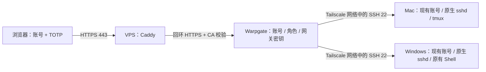

# Warpgate + Tailscale + Mac / Windows

浏览器通过域名 HTTPS 登录 VPS 上的 Warpgate，再由网关经 Tailscale 连接 Mac 或 Windows 的原生 OpenSSH。网页账号集中管理；后端只需信任网关专用公钥。新增浏览器或网页用户不用再改后端。仓库名称保留，Windows 入口见 [Windows 完整 SOP](docs/WINDOWS.md)。

这是独立部署项目。发布基线为 Warpgate **0.30.2**、Caddy **2.11.7**、可选 Tailscale 静态包 **1.104.2**，下载地址与 SHA256 固定在 `config/versions.lock.json`。小规模使用原生二进制、systemd 和 SQLite，无 Node、插件运行时或外部数据库。



## 两端分别负责什么

| 位置 | 配置 |
|---|---|
| DNS | 独立子域名 A 记录指向 VPS 公网 IPv4 |
| VPS | Tailscale 节点；Warpgate 回环监听；Caddy 自动公网证书；账号、TOTP、角色、会话记录；凭据加密与备份 |
| Mac | 复用已有普通或管理员账号；原生远程登录；网关公钥仅限 VPS 来源；该来源关闭转发；tmux 持久终端 |
| Windows | 复用已有本地普通或管理员账号；原生 OpenSSH；网关身份限定账号和 VPS 来源；保留原有 Shell，无断线会话恢复 |
| 浏览器客户端 | 访问 HTTPS 域名，完成密码与 TOTP；不需要 SSH 私钥或 VPN 客户端 |

## 部署顺序

远端账号默认复用，无需新建。`--user` / `serverUser` 必须指定真实已有的系统账号。VPS 上的 wg-gateway、wg-https 仍是独立服务身份，与远端登录账号无关。

1. [VPS 安装与启用](docs/VPS.md)：准备域名和 `local/site.json`，安装/登录 Tailscale，然后执行 VPS 安装器。先备份密钥，再启动 HTTPS 并完成管理员 TOTP。
2. [Tailscale 网络权限](docs/TAILSCALE.md)：VPS 到指定 Mac/Windows 仅允许 TCP 22，移除与此边界冲突的宽泛规则。
3. 按后端系统选择：[Mac](docs/MAC.md) 运行 `setup_mac.py`，默认安装 tmux；[Windows](docs/WINDOWS.md) 运行 `setup_windows.ps1 -OnServer -Setup ...`，保留现有默认 Shell。两种安装器都只能在真正的远端服务器运行。
4. 从远端服务器的可信渠道取得回执，在 Warpgate 登记主机公钥、建立 SSH Target，分配普通用户角色。
5. [验收、备份和恢复](docs/OPERATIONS.md)：完成真实链路、撤权、重启和恢复验收后日常使用。

## 默认安全边界

- Warpgate 仅监听 `127.0.0.1`；其 SSH、数据库、Kubernetes、RDP、VNC 监听关闭。宿主机原有管理 SSH 保留。
- Caddy 代理内部 TLS 使用私有 CA 校验，未使用跳过证书校验的选项；代理覆盖客户端提供的来源头，避免伪造登录来源。
- 初始化生成随机凭据加密密钥，应用进程以独立非登录用户运行。生产服务不启用管理员 Token。
- 全局强制 MFA、防爆破、16 位复杂密码、关闭自助 ticket、启用会话记录、未知主机公钥直接拒绝；旧 SSH 算法关闭。
- 远端 Mac/Windows 不创建用户、不重设密码；允许复用管理员账号。加固仅匹配该账号从指定 VPS 发起的连接，保留原公钥文件、其他来源和其他账号的设置。
- 真实域名、IP、回执和运行数据放在被 Git 忽略的 `local/`；私钥、密码、数据库和加密密钥不入库。

复用账号可使用其原有文件、工具和权限；管理员账号不会因此降权。多个网页用户共用同一 Mac/Windows 系统账号时，仍共享文件、权限和会话；仅向可信用户授予这类 Target。撤销角色会关闭连接，不能保证已经脱离 SSH 的后台任务停止。

## 持久终端

本节仅适用于 Mac。Windows 原生方案不使用 tmux；不保证关网页后任务继续运行，也不提供原交互会话恢复。

新增 Mac 后端默认带上：登录网页 → 点击对应 Target → 自动进入该账号的 `work` 会话。关闭网页或连接中断后任务继续留在远端；下次点同一目标即可恢复。`Ctrl+b` 后按 `d` 可主动分离，`remote-resume` 可手动恢复。

安装器下载并校验锁定的官方 tmux **3.7c** macOS 包，支持 Apple Silicon / Intel，要求 **macOS 15+、Python 3.9+、账号使用 `/bin/zsh`**，无需 Homebrew。系统已有 tmux 和默认配置不会被替换。回滚方法、旧配置迁移及限制见 [持久会话说明](docs/SESSIONS.md)。tmux 不保证关机、重启或进程崩溃后的任务恢复。

## 验证与限制

运行无需权限的配置测试：

```sh
python3 -m unittest discover -s tests -v
bash -n scripts/backup-vps.sh scripts/check-vps.sh
python3 scripts/check_tracked.py --history
```

有编译好的 Warpgate 和 Caddy 时，可在临时目录运行真正的初始化、TLS、策略读回和私钥加密测试：

```sh
WG_TEST_BINARY=/absolute/path/to/warpgate \
CADDY_TEST_BINARY=/absolute/path/to/caddy \
python3 -m unittest discover -s tests -v
```

本仓库的配置测试与回环集成测试不代表已经在你的 VPS/远端 Mac 上完成部署。服务器安装器不会自动开启公网服务；Mac 安装器不会自动打开远程登录、关闭 FileVault 或更改休眠策略。

当前 Warpgate 锁文件仍有 RustSec 依赖匹配记录。加固配置不是依赖修复；需要持续跟进上游安全发布。详见 [安全边界与维护](docs/SECURITY.md)。
